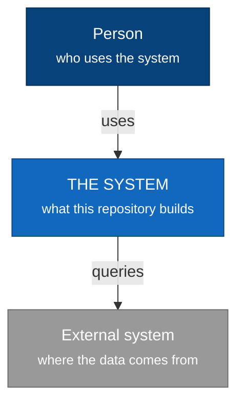

<!-- anchors:generated from doct/architecture.md.tmpl — inputs:4541eb57cf9ad5f2 — DO NOT EDIT: run `anchors docs build` -->

# Architecture

## Level 1 — Context

The system as a single box: who uses it, and which external systems it talks to.

<!-- OUTSIDE this level: how the system is built inside. That is level 2. -->

## Level 2 — Containers

The zoom into the box "THE SYSTEM": what runs or stores data apart, and **which protocol each
pair talks**. The protocol is what says what happens when the conversation fails.

> **No container declared.** Level 2 and the level 3 ones stay empty until the configuration
> declares what runs apart. See the containers block in `anchors.yaml`.

<!-- OUTSIDE this level: the pieces INSIDE each container. That is level 3 — and there is one
     diagram per container, because each level zooms into ONE box of the previous one. -->

## Level 3 — Components

One diagram **per container**: each zooms into one box of level 2. External containers do
not show here — we have no components inside them, and drawing them would claim a
knowledge we do not have.

### Layers outside every container

These layers exist in the project and no container declares them — they show in no level 3
diagram. Either they still have to be declared, or they run nowhere:

- `apoio`
- `comando`
- `config`
- `doct`
- `gate`
- `infra`
- `mapa`
- `mapx`
- `migra`
- `scan`

## Level 4 — Code

<!-- Only where there is something not obvious. The map Anchors keeps is already the machine
     version, and repeating it here would be duplication with no reader. -->

_Nothing to highlight for now._
